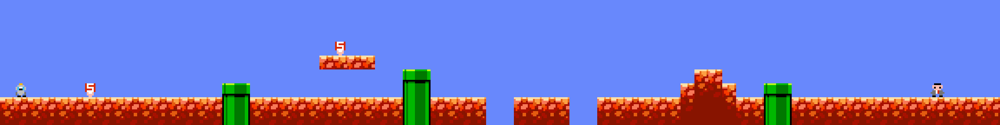

# super-intelligence-bros
どこかで見たことがある気がするプラットフォーマーだと思う。

AI エージェント（LLM）が MCP 経由で遊べる、マリオっぽい横スクロールアクションです。
ロボットの「エスアイくん」を操作して、偉そうなスーツのおっさん「スーパー部長」を踏み倒すのが目的です。



- ゲームの中身は Bevy をヘッドレスで動かしたもの（描画は別バイナリ）
- 1 tick = 1/60 秒で固定。同じ入力なら必ず同じ結果になる（リプレイ・再現しやすい）
- 画面はテキストにして返すので、画像を読めないモデルでも遊べる

## 動かし方

Rust（edition 2024 が使えるもの）が必要です。

```sh
# 動作デモ（走って、Sキノコを取って、土管を越える）
cargo run

# テスト
cargo test

# MCP サーバーをビルド
cargo build --release --bin sibros-mcp
```

## 画面で遊ぶ（描画版 `sibros-view`）

Bevy の描画つきビューアです。ゲームのルールはヘッドレス版と同じコアを使っています。
描画まわりの依存は大きいので、`view` feature を付けたときだけビルドされます。

```sh
cargo run --features view --bin sibros-view            # 初期ステージ
cargo run --features view --bin sibros-view my_stage.txt  # ステージのテキストファイルを指定
```

- 操作: `←` `→` / `A` `D` で移動、`Space` / `Z` / `↑` / `W` でジャンプ、`R` でやり直し
- 画面の文字は ASCII のみです（Bevy 標準のフォントが日本語に対応していないため）
- Linux では X11（Wayland 環境でも XWayland 経由）で動かす構成にしています
- **注意**: 開発環境に GPU も画面もなかったため、ビルドが通ることと、ウィンドウを作る前までの動作は確認していますが、
  **実際の描画・入力は未確認**です。動かない・見た目がおかしいときは Issue などで教えてください。
  見た目の割り当ては、下の `sibros-snap` で PNG にして確認しています

### 画像で確認する（`sibros-snap`）

GPU もウィンドウも使わずに、ステージの絵を CPU で PNG に書き出します。描画版と同じ割り当て（`src/visual.rs`）を使います。

```sh
cargo run --bin sibros-snap -- out.png                          # 初期ステージ
cargo run --bin sibros-snap -- out.png --run "right:130,right+jump:12"   # 入力を流した後の絵
cargo run --bin sibros-snap -- out.png --level my_stage.txt --scale 6
```

## MCP サーバーとして使う

stdio で動きます。Claude Code なら次のように登録できます。

```sh
claude mcp add sibros -- /path/to/target/release/sibros-mcp
```

### ツール

| ツール | 内容 |
| --- | --- |
| `step` | `left` / `right` / `jump` を押したまま `frames` フレーム（1〜600、省略時 10）進めて、状態を返す |
| `observe` | 時間を進めずに現在の状態を返す |
| `reset` | 今のステージを最初からやり直す |
| `load_level` | ステージをテキストで差し替える（検証に通らなければ理由を返し、今のステージはそのまま） |
| `solve` | 今のステージが最初からクリアできるか探索する（ゲームの進行状態は変えない）。解けたら入力列を返す |

### `observe` の見方

```
tick=60 status=playing form=SI
player: pos=(7.50,6.55) vel=(6.00,0.00) on_ground=true
boss: hp=3 sign=SI pos=(65.50,6.55)
........................................................................
........................................................................
........................................................................
........................S...............................................
.......................####.............................................
.............................PP...................##....................
.......@........PP...........PP..................####..PP........B......
################PP###########PP####..####..############PP###############
################PP###########PP####..####..############PP###############
events:
- [tick 42] Sキノコを取った。看板が AI から SI に変わった。中身は何も変わっていない。
```

- 座標はタイル単位で、y は下向きが正（グリッドの行と同じ向き）
- `events` は前回の `observe` / `step` 以降に起きたこと。読んだら空になる
- `status` は `playing` / `dead` / `cleared`。終了後は `reset` で再開

## ルール

| 記号 | 意味 |
| --- | --- |
| `@` | エスアイくん（自分） |
| `B` | スーパー部長。左右にうろうろして、ときどき叫ぶ |
| `S` | Sキノコ。取ると看板が AI → SI になる（**見た目だけで強さは変わらない**） |
| `G` | ゴール。触れるとクリア |
| `#` | 地面・ブロック |
| `P` | 土管 |
| `.` | 空気 |

- **クリア条件**: ステージに `G` があれば、`G` に触れるとクリア。`G` がなければ、ボスを倒すとクリア
- ボスは**上から踏む**とHPが減る（HP 3、3回踏むと倒せる）。踏むと看板が一瞬 AI に戻って動きが止まる
- ボスに**横から当たる**と、SI なら AI に戻るだけ（短い無敵つき）、AI ならやられる
- 奈落に落ちてもやられる

## ステージを作る

`load_level` にテキストを渡すと、ステージを差し替えられます。1 行が 1 段で、全行を同じ幅にします。

```
........................
........................
.@..........S......B....
########################
```

- `@`（プレイヤー開始位置）はちょうど 1 つ必要
- `B`（ボス）、`G`（ゴール）はそれぞれ最大 1 つ
- 使える文字は `. # P S B G @` のみ。最大 200 列 × 50 行

## クリアできるか調べる（`solve`）

ゲームは決定的なので、入力を探索して「このステージはクリアできるか」を調べられます。
ステージを作ったあとに `solve` を呼ぶと、次のどれかが返ります。

| 結果 | 意味 |
| --- | --- |
| `solved` | クリアできる入力列が見つかった（`step` で再生すると本当にクリアになる） |
| `unreachable` | 1フレーム刻み・3600 tick（60秒）以内で探索しきっても見つからなかった |
| `gave_up` | 時間や探索数の上限で打ち切った。**クリア可否は不明** |

`unreachable` は、入力の粒度と時間の範囲での結論です。「どんな操作でも絶対に不可能」という証明ではありません。
また、広い穴を渡るステージなど、状態が多くなりすぎるものは `gave_up` になることがあります
（その場合は `max_seconds` を延ばすか、ステージを簡単にしてみてください）。

## 構成

```
src/lib.rs            ゲームのコア（物理・ボス・アイテム・ゴール・ステージ検証・step/observe・スナップショット）
src/solver.rs         ステージの解法探索（最良優先探索）
src/visual.rs         見た目の割り当て（どのマスにどのタイル/スプライトを描くか。描画エンジンに依存しない）
src/main.rs           動作デモ
src/bin/sibros-mcp.rs MCP サーバー（rmcp, stdio）
src/bin/sibros-snap.rs ステージを CPU で PNG に書き出す
src/bin/sibros-view.rs Bevy の描画つきビューア（--features view）
assets/               タイルシートとスプライト（クレジットは assets/CREDITS.md）
tools/gen_sprites.py  assets/sprites.png の生成スクリプト
```

Bevy の `App` は `Send` ではないため、MCP サーバーはゲームを専用スレッドに置き、チャンネルでコマンドを送っています。

## 今後やりたいこと

- ステージエディットモード（`set_tile` / `fill_rect` などの部分編集ツール）
- 敵・アイテムの追加（関税ブロックのような、触ると効果のあるタイルなど）
- 「作る側」と「攻略する側」を別のモデルにして対決させるモード
- 描画版の動作確認（実機での入力・見た目）と、画面での日本語表示（日本語フォントの同梱）
- 描画版でボスのセリフ（「それはAIじゃない、SIだ！」）を出す

## 素材とクレジット

- タイル: **「1985」 by Adam Saltsman** — https://adamatomic.itch.io/1985 （配布ページでパブリックドメインとされている）
- キャラクター・アイテムのスプライトは、このプロジェクトのオリジナル（`tools/gen_sprites.py` で生成）

詳しくは `assets/CREDITS.md`。

## ライセンス

MIT
